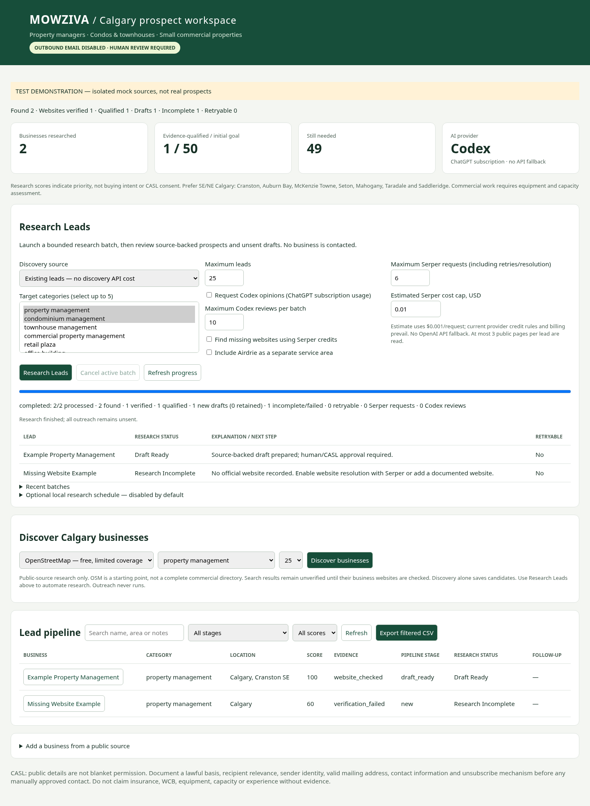

# Batch upgrade validation — 2026-10-29

## Executed checks

| Check | Result |
| --- | --- |
| Focused MOWZIVA and batch regression suite | **57 passed**, 2.69 seconds |
| Complete repository suite | **2,462 passed, 26 skipped**, 24 deprecation warnings, 82.60 seconds; no failures/errors |
| Real Chromium, desktop and mobile | Passed: token unlock, schedule disabled, batch launch/progress, one verified lead plus one incomplete lead, sourced contact details, unsent draft, CSV download, no JavaScript errors or page overflow |
| Existing SQLite backup | New backup helper executed successfully against the existing database, with integrity check; backup stays private under ignored `data/backups/` |
| Existing real lead database | Integrity check `ok`; zero company rows, unchanged by test/demo seeding |
| Source security boundary | Existing IP-pinned public HTTP transport and dashboard guards retained; regression coverage includes origin/authentication, private-target rejection, robots disallow/redirect handling and no social-profile scraping as an official site |
| Outreach | Email/LinkedIn configuration unchanged and disabled; zero email cap; MOWZIVA still exposes no sending endpoint |
| Secret review | Changed source/docs/tests reviewed and scanned. Only an existing adversarial URL test fixture matched a credential-URL pattern; no live credentials were found. Tokens, databases, backups, `.env`, caches and downloaded tools are excluded |

Regression cases include discovery failure and actionable provider guidance, cached searches/pages, paid request caps, no paid-timeout replay, bounded 429 retry/backoff and persistent cooldown, missing/unresolvable websites, normalized-domain deduplication, source timestamps, published email/role context, insufficient qualification evidence, unavailable Codex, verbatim-only model evidence quotes, Codex review limits, partial enrichment failures, per-lead failure isolation, cancellation before/during work, interrupted-job recovery, opt-in scheduling, Airdrie separation, selected-category filtering, preservation of human notes/consent/prior drafts, and prevention of a second service instance interrupting an active database.

Skipped tests are not claimed as passes. The skipped upstream checks are opt-in/platform-specific. Existing deprecation warnings concern upstream datetime usage and Starlette/httpx compatibility; they do not indicate new test failures.

The screenshot is explicitly labelled **test demonstration**. Example businesses and responses came from an isolated temporary SQLite database and mocked public sites. They were never inserted into the real lead database. Browser checks did not submit contact forms, contact businesses or spend paid credits.

## Live dependencies not claimed as validated

- **Serper:** no key is configured in this cloud instance. Tests use a mock API; no paid search was run. Configure `SERPER_API_KEY` privately in the WSL installation for broader discovery or optional official-site resolution. Current pricing/trial terms must be checked with the provider.
- **Codex:** the native subscription login is present, but the current real preflight exits **1** and reports that it is expired or due for renewal. No live inference was run. The upgrade retains the supported local CLI and subscription-only runtime; it never falls back to Claude or a separately billed OpenAI API.
- **Source access:** tests establish application error/retry/security behavior, not live coverage or provider availability. Prior cloud runs showed Overpass HTTP 406 and protected website-transport connectivity limitations; restricted cloud networking is not bypassed. WSL2 must have ordinary supported public-network access. Individual external sites can still deny requests or require human research, and OSM can remain sparse.
- No new verified Calgary leads or live conversion results are claimed by this implementation test. Launch a small real batch after configuring the chosen source and renewing Codex as needed.

See [AUTONOMOUS_RESEARCH.md](AUTONOMOUS_RESEARCH.md) for architecture, sources/costs and limits, and [WSL2_UPGRADE.md](WSL2_UPGRADE.md) for backup and upgrade instructions. Merging, enabling outreach and contacting businesses remain outside this change.
